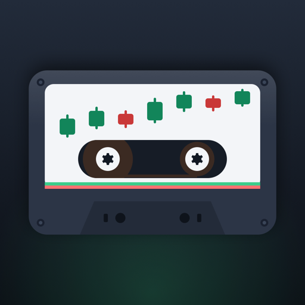
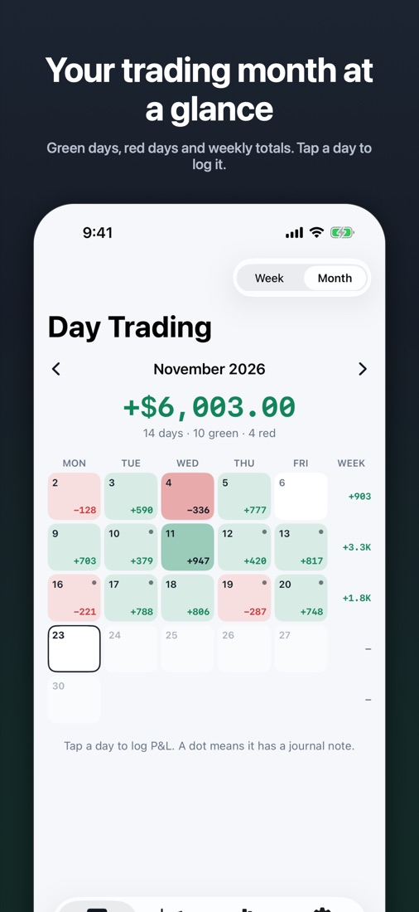
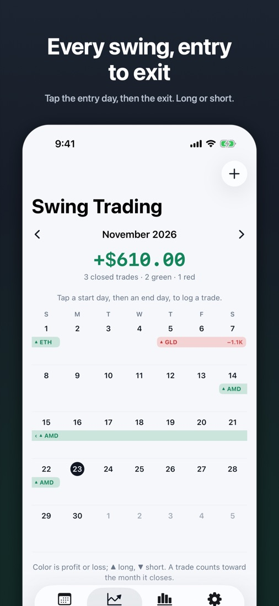
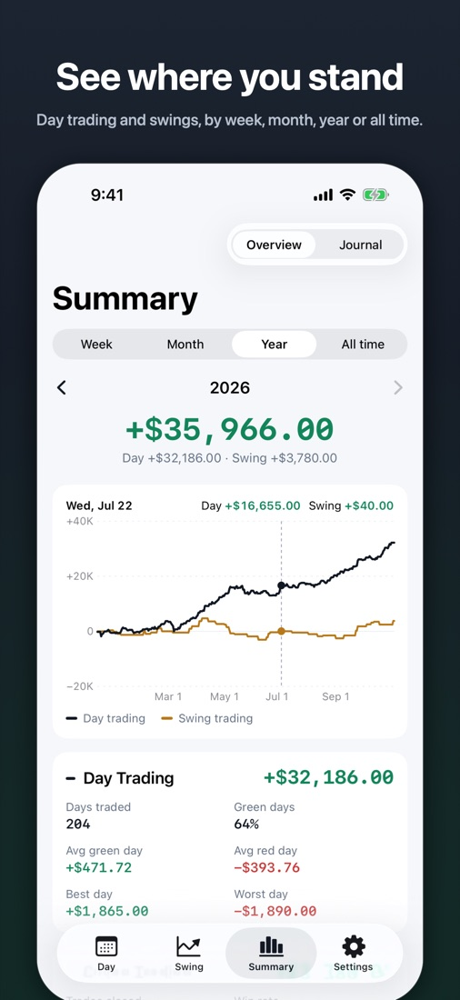

  
  <h1>Tape</h1>
  
Trading Journal

  
Log each day's P&amp;L and every swing trade on a calendar. See how it all adds up. Everything stays on your device.

  
  
  
  
Coming soon to the App Store · iPhone, iPad and Mac

  
  

    
    
    
    
    
    
    
  

  
  
  

  

    <h3>Log a day in seconds</h3>
    
Tap a day, enter your P&amp;L, add a note. Your month fills in green and red.

  

  

    <h3>Every swing, entry to exit</h3>
    
Each trade shows as a bar across the days you held it: ticker, long or short, P&amp;L.

  

  

    <h3>See where you stand</h3>
    
Week, month, year or all time: net P&amp;L, win rate, best and worst, average hold.

  

  

    <h3>Private by design</h3>
    
No account, no cloud, no ads. Face ID lock, hide amounts, export to CSV.

  

  <a href="support/">Support</a> · <a href="privacy-policy/">Privacy Policy</a>

